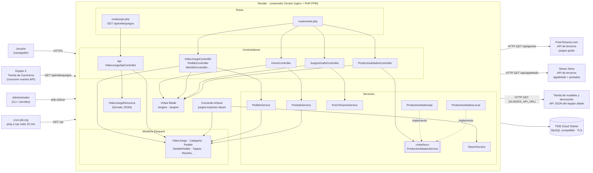
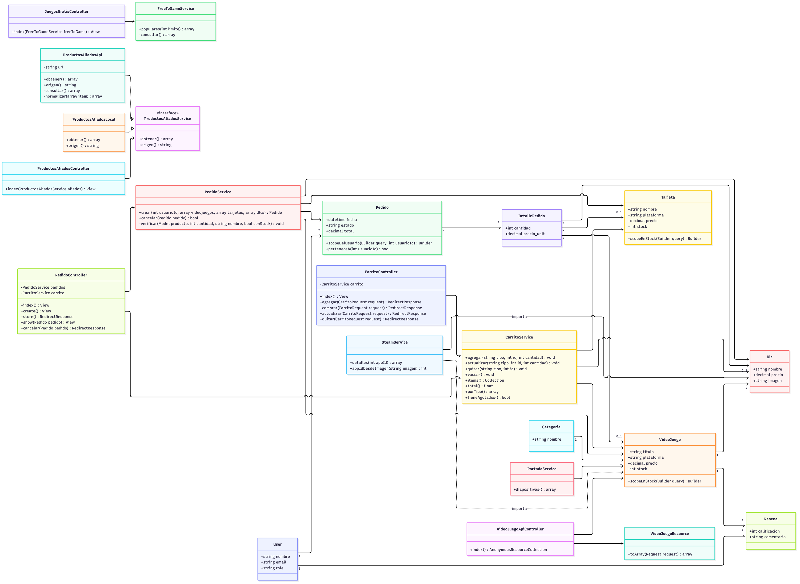

# Diagramas de GameVault (Entregable 2)

Las fuentes están en Mermaid (`.mmd`) y las imágenes se regeneran con:

```bash
npx -p @mermaid-js/mermaid-cli mmdc -i arquitectura.mmd -o arquitectura.png -b white -w 2200
npx -p @mermaid-js/mermaid-cli mmdc -i clases.mmd -o clases.png -b white -w 2200
```

## Arquitectura



- **Servicio provisto:** el Equipo 2 (Tienda de Carnicería) consume `GET /api/videojuegos` (`Api/VideoJuegoApiController` + `VideoJuegoResource`).
- **Servicio consumido:** `/productos-aliados` lee la API de la Tienda de muebles y decoración configurada en `ALIADOS_API_URL`.
- **APIs de terceros:** `/juegos-gratis` consume la API pública de FreeToGame (`FreeToGameService`) y el comando `juegos:importar-steam` consume la API de Steam (`SteamService`) para traer nombre, descripción, precio y portada de juegos reales.
- **PortadaService:** arma las diapositivas del carrusel de la página de inicio (`HomeController`) a partir de los videojuegos guardados.
- **Inversión de dependencias:** `ProductosAliadosController` depende de la interfaz `ProductosAliadosService`; `AppServiceProvider` inyecta `ProductosAliadosApi` si hay URL configurada o `ProductosAliadosLocal` si no.
- **Despliegue:** contenedor Docker en Render, base de datos TiDB Cloud (compatible con MySQL, conexión TLS) y un ping de cron-job.org para evitar que el plan gratuito se duerma.

## Clases


